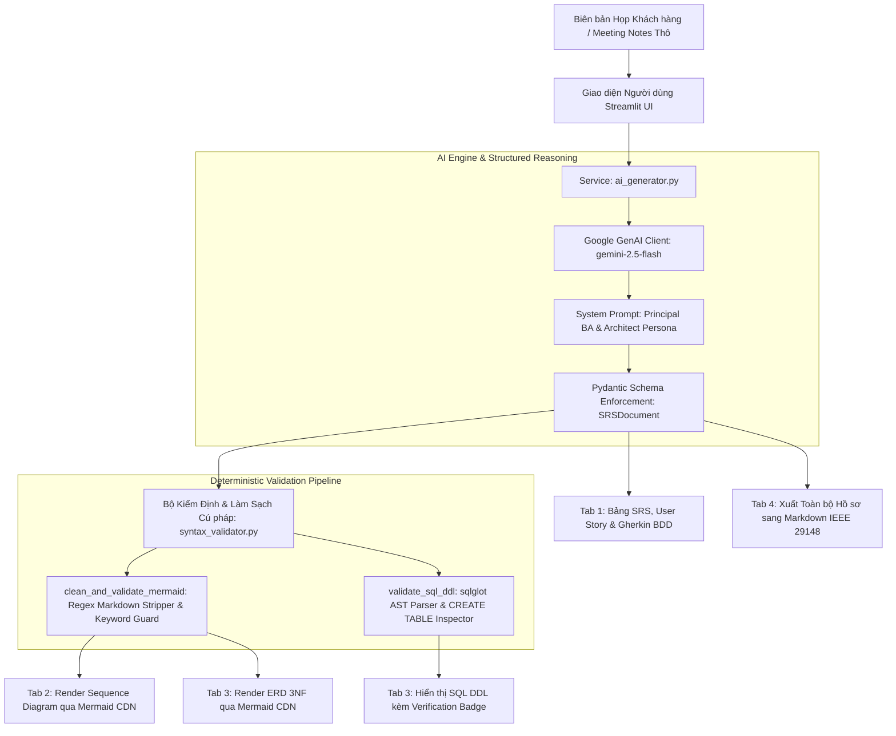

# 📐 ba-srs-uml-copilot: AI Business Analyst & System Architect Copilot

[](https://www.python.org/)
[](https://streamlit.io/)
[](https://ai.google.dev/)
[](https://docs.pydantic.dev/)
[](https://github.com/tobymao/sqlglot)
[](#điểm-nhấn-kỹ-thuật)
[](LICENSE)

> **Tự động hóa phân tích yêu cầu phần mềm chuẩn công nghiệp:** Chuyển hóa biên bản họp khách hàng thô (Meeting Notes) thành Đặc tả Yêu cầu SRS chuẩn **IEEE 29148 / BABOK v3**, Sơ đồ Tuần tự **UML Sequence Diagram**, Sơ đồ Thực thể Quan hệ **ERD Chuẩn 3NF** và Kịch bản **SQL DDL** được xác thực cú pháp AST.

---

## 🎯 Tổng quan Bài toán (Problem Statement)

Trong quy trình phát triển phần mềm chuẩn CMMI / Agile, khoảng trống lớn nhất giữa **Business Stakeholders** và **Engineering Team** nằm ở khâu phân tích yêu cầu:
1. **Ghi chú phân tán & mơ hồ:** Ghi chú họp khách hàng thường lộn xộn, thiếu cấu trúc, không rõ ràng về phạm vi (Scope Creep) và tác nhân (Actors).
2. **Tiêu chí nghiệm thu thiếu chuẩn mực:** Yêu cầu chức năng thường được viết chung chung, thiếu kịch bản kiểm thử (Acceptance Criteria), dẫn đến tranh cãi khi bàn giao sản phẩm.
3. **Mô hình hóa CSDL sai chuẩn:** Cơ sở dữ liệu thường bị dư thừa dữ liệu hoặc vi phạm các dạng chuẩn (1NF, 2NF, 3NF), dẫn đến dị thường khi cập nhật (Update Anomalies) và lỗi khóa ngoại.
4. **Mất nhiều thời gian chuyển đổi thủ công:** Một Business Analyst (BA) hoặc System Architect mất trung bình từ 3 đến 5 ngày để tổng hợp SRS, vẽ sơ đồ Sequence, thiết kế ERD và viết script SQL DDL.

**`ba-srs-uml-copilot`** giải quyết triệt để bài toán trên bằng cách đóng vai một **Principal Business Analyst (chứng chỉ IIBA CBAP)** và **Senior Database Architect**, tự động hóa toàn bộ chuỗi giá trị phân tích chỉ trong vài chục giây với độ chính xác cao và định dạng chuẩn mực.

---

## 🏗️ Kiến trúc Hệ thống (System Architecture)



---

## 💡 Điểm nhấn Kỹ thuật (Technical Highlights)

### 1. Chuẩn hóa Đặc tả IEEE 29148 & BABOK Guide v3
- Phân rã mục tiêu kinh doanh (Business Objective) và phạm vi hệ thống rõ ràng.
- Định danh tác nhân (Actors), ánh xạ User Story chuẩn: `Là [tác nhân], tôi muốn [hành động], để [mục đích]`.
- Phân loại độ ưu tiên theo chuẩn **MoSCoW** (Must Have, Should Have, Could Have) hoặc High/Medium/Low.

### 2. Tiêu chí Chấp nhận Chuẩn BDD Gherkin (Given - When - Then)
- Mọi yêu cầu chức năng (Functional Requirement) đều đi kèm các kịch bản kiểm thử độc lập:
  - **Given:** Tiền điều kiện hoặc trạng thái ban đầu của hệ thống.
  - **When:** Sự kiện hoặc hành động kích hoạt từ phía tác nhân.
  - **Then:** Kết quả mong đợi và trạng thái thay đổi của hệ thống.
- Sẵn sàng chuyển giao cho QA/QC tự động hóa thành Test Cases (Cucumber / Behave / Playwright).

### 3. Thiết kế CSDL Chuẩn Dạng 3 (Third Normal Form - 3NF)
- Triệt tiêu hoàn toàn trùng lặp dữ liệu (1NF).
- Đảm bảo mọi thuộc tính phi khóa phụ thuộc đầy đủ vào khóa chính (2NF).
- Loại bỏ triệt để phụ thuộc bắc cầu (3NF), ngăn chặn hiện tượng bất thường khi thêm/xóa/sửa (Anomalies).

### 4. Kiểm định Cú pháp Tất định (Deterministic AST Validation)
- **SQL DDL Validation:** Sử dụng thư viện `sqlglot` để phân tích cây cú pháp trừu tượng (Abstract Syntax Tree - AST), bảo đảm tất cả các câu lệnh `CREATE TABLE`, khóa chính, khóa ngoại `REFERENCES` không bị lỗi cú pháp trước khi hiển thị.
- **Mermaid Markdown Guard:** Tự động loại bỏ các thẻ markdown thừa (như ```` ```mermaid ```` và ```` ``` ````) do LLM sinh ra, đồng thời xác thực từ khóa đầu dòng (`sequenceDiagram` hoặc `erDiagram`).

### 5. Ép kiểu Đầu ra 100% bằng Pydantic V2 & Gemini Structured Outputs
- Ứng dụng tính năng `response_mime_type="application/json"` và `response_schema=SRSDocument` của SDK `google-genai` mới nhất, loại bỏ hoàn toàn hiện tượng ảo giác (hallucination) về cấu trúc schema JSON.

---

## 📂 Cấu trúc Thư mục Dự án

```text
ba-srs-uml-copilot/
├── .env.example              # Khai báo biến môi trường mẫu
├── .gitignore                # Danh sách loại trừ Git chuẩn Python
├── requirements.txt          # Các thư viện phụ thuộc (Streamlit, Pydantic, GenAI, SQLGlot)
├── README.md                 # Tài liệu hướng dẫn chuẩn công nghiệp
├── src/
│   ├── __init__.py
│   ├── app.py                # Giao diện web Streamlit (4 Tabs + Mermaid CDN)
│   ├── data/
│   │   ├── __init__.py
│   │   └── sample_inputs.py  # 3 kịch bản khảo sát thực tế (Cinema, Bus, WMS)
│   ├── models/
│   │   ├── __init__.py
│   │   └── srs_schema.py     # Pydantic Schemas (SRSDocument, FR, NFR, AC)
│   ├── services/
│   │   ├── __init__.py
│   │   └── ai_generator.py   # Tích hợp Gemini 2.5 Flash Structured Outputs
│   └── validators/
│       ├── __init__.py
│       └── syntax_validator.py # Bộ tiền xử lý Mermaid & AST Validator SQLGlot
└── tests/
    ├── __init__.py
    ├── test_schemas.py       # Unit test Pydantic serialization & validation
    └── test_validators.py    # Unit test Mermaid sanitizer & SQLGlot DDL parser
```

---

## 🚀 Hướng dẫn Cài đặt & Khởi chạy

### 1. Yêu cầu Tiên quyết
- **Python:** Phiên bản 3.11, 3.12 hoặc 3.13.
- **Google Gemini API Key:** Đăng ký miễn phí tại [Google AI Studio](https://aistudio.google.com/).

### 2. Cài đặt Môi trường
Clone repository về máy và kích hoạt môi trường ảo:

```bash
# Clone repository
git clone https://github.com/daongochan/ba-srs-uml-copilot.git
cd ba-srs-uml-copilot

# Tạo môi trường ảo
python -m venv .venv

# Kích hoạt môi trường (Windows PowerShell)
.venv\Scripts\Activate.ps1

# Hoặc kích hoạt trên Linux / macOS
# source .venv/bin/activate

# Cài đặt các thư viện cần thiết
pip install -r requirements.txt
```

### 3. Cấu hình Khóa API
Sao chép file `.env.example` thành `.env` và điền khóa API của bạn:

```bash
cp .env.example .env
```

Mở `.env` và chỉnh sửa:
```ini
GEMINI_API_KEY=AIzaSy...your_gemini_api_key_here
```

### 4. Khởi chạy Ứng dụng Streamlit
Chạy lệnh sau để khởi động ứng dụng web trên trình duyệt:

```bash
streamlit run src/app.py
```

Truy cập ứng dụng tại: `http://localhost:8501`

---

## 🧪 Kiểm thử Tự động (Testing Suite)

Dự án tích hợp bộ kiểm thử đơn vị tự động với `pytest`:

```bash
pytest -v
```

Kết quả kiểm thử đạt **100% Passed (14/14 tests)**:
```text
tests/test_schemas.py::test_srs_document_instantiation_and_validation PASSED
tests/test_validators.py::TestMermaidValidator::test_clean_sequence_diagram_with_markdown_fence PASSED
tests/test_validators.py::TestMermaidValidator::test_clean_er_diagram_with_generic_code_fence PASSED
tests/test_validators.py::TestMermaidValidator::test_mermaid_already_clean PASSED
tests/test_validators.py::TestMermaidValidator::test_mermaid_with_leading_comments PASSED
tests/test_validators.py::TestMermaidValidator::test_mermaid_case_insensitive_keyword PASSED
tests/test_validators.py::TestMermaidValidator::test_invalid_mermaid_keyword PASSED
tests/test_validators.py::TestMermaidValidator::test_empty_mermaid_raises_error PASSED
tests/test_validators.py::TestMermaidValidator::test_no_valid_syntax_raises_error PASSED
tests/test_validators.py::TestSqlDdlValidator::test_valid_single_create_table_with_markdown PASSED
tests/test_validators.py::TestSqlDdlValidator::test_valid_multiple_create_tables_and_foreign_keys PASSED
tests/test_validators.py::TestSqlDdlValidator::test_empty_sql_script PASSED
tests/test_validators.py::TestSqlDdlValidator::test_sql_with_syntax_error PASSED
tests/test_validators.py::TestSqlDdlValidator::test_sql_without_create_table PASSED
```

---

## 📝 3 Kịch bản Mẫu Tích hợp Sẵn

Người dùng có thể bấm nạp nhanh 1 trong 3 kịch bản thực tế ngay trên giao diện để trải nghiệm:
1. **🎬 Rạp chiếu phim CineMax:** Quản lý cụm rạp, phòng chiếu IMAX/VIP, cơ chế khóa ghế tạm thời 10 phút (Seat Lock), đặt vé đa kênh và combo bắp nước.
2. **🚌 Xe khách Liên tỉnh Phương Nam Express:** Quản lý đội xe 150 phương tiện, tuyến đường và trạm dừng, đặt chỗ theo sơ đồ giường nằm 2 tầng, ký gửi bưu kiện theo mã vận đơn Barcode/QR.
3. **📦 Quản trị Kho Thông minh LogiTech Pro:** Quản lý danh mục hàng hóa theo mô hình Kệ - Tầng - Ô (Bin-Location), nhập kho theo PO, xuất kho FIFO theo Pick List thông minh, kiểm kê định kỳ và cảnh báo tồn tối thiểu.

---

## 📄 Bản quyền & Đóng góp (License)
Dự án được phân phối dưới giấy phép [MIT License](LICENSE). Mọi đóng góp (Pull Request, Issue) đều được chào đón nhằm hoàn thiện giải pháp phân tích yêu cầu phần mềm tự động hóa.
