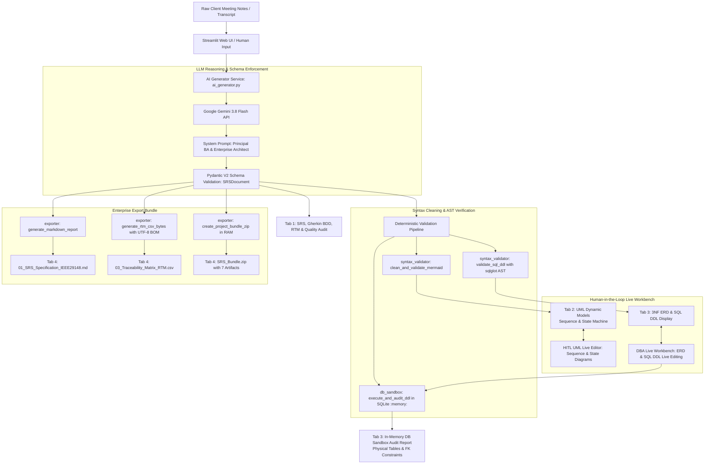

# 📐 BA & System Architect Copilot | Enterprise Requirements, UML Modeling & 3NF Database Sandbox

[](https://github.com/daongochan/ba-srs-uml-copilot/actions/workflows/ci_test.yml)
[](https://www.python.org/)
[](https://streamlit.io/)
[](https://ai.google.dev/)
[](https://docs.pydantic.dev/)
[](https://github.com/tobymao/sqlglot)
[-success.svg)](tests/)
[](#3-core-technical-highlights)
[](LICENSE)

> **Enterprise-Grade AI Copilot for Business Analysts & Solution Architects:** Automatically transforms unstructured client meeting notes into formal **IEEE 29148 & BABOK v3** Software Requirements Specifications (SRS), dynamic **UML Sequence & State Machine Diagrams**, **3NF Entity-Relationship Diagrams**, and PostgreSQL **SQL DDL scripts** verified in real-time within an **In-Memory SQLite Sandbox**.

---

## 📑 Table of Contents
- [1. Executive Summary & Problem Statement](#1-executive-summary--problem-statement)
- [2. System Architecture & Workflow](#2-system-architecture--workflow)
- [3. Core Technical Highlights](#3-core-technical-highlights)
  - [3.1. Zero-Hallucination Structured Outputs (Pydantic V2 & Gemini)](#31-zero-hallucination-structured-outputs-pydantic-v2--gemini)
  - [3.2. BABOK v3 Traceability Matrix (RTM) & IEEE 29148 Quality Audit](#32-babok-v3-traceability-matrix-rtm--ieee-29148-quality-audit)
  - [3.3. Deterministic AST Parsing & In-Memory SQLite Sandbox](#33-deterministic-ast-parsing--in-memory-sqlite-sandbox)
  - [3.4. Dynamic UML Modeling (Sequence & State Machine Diagrams)](#34-dynamic-uml-modeling-sequence--state-machine-diagrams)
  - [3.5. Human-in-the-Loop (HITL) Live Workbench](#35-human-in-the-loop-hitl-live-workbench)
  - [3.6. Resilient Lazy Visibility Rendering](#36-resilient-lazy-visibility-rendering)
  - [3.7. Enterprise Multi-Format Export Bundle](#37-enterprise-multi-format-export-bundle)
- [4. Project Structure](#4-project-structure)
- [5. Quick Start & Installation Guide](#5-quick-start--installation-guide)
- [6. Automated Testing & CI/CD Pipeline](#6-automated-testing--cicd-pipeline)
- [7. Built-in Industry Demonstration Scenarios](#7-built-in-industry-demonstration-scenarios)
- [8. Author & Professional Profile](#8-author--professional-profile)
- [9. License](#9-license)

---

## 1. Executive Summary & Problem Statement

In enterprise software engineering and IT consulting, the bridge between **Business Stakeholders** and **Software Engineering Teams** is notoriously error-prone and labor-intensive:

1. **Fragmented & Ambiguous Requirements:** Meeting transcripts and client notes are inherently unstructured, laden with implicit assumptions and unstated boundaries, leading directly to scope creep and expensive rework.
2. **Untestable Acceptance Criteria:** Functional requirements often lack formalized acceptance criteria, causing friction during User Acceptance Testing (UAT).
3. **Improper Database Normalization:** Novice architects frequently produce schemas violating normalization rules (1NF, 2NF, 3NF), creating transitive dependencies, update anomalies, and broken foreign key references.
4. **Time & Effort Bottlenecks:** A Senior Business Analyst typically spends 3 to 5 business days synthesizing notes into formal SRS, drawing UML diagrams, designing ERDs, and drafting database DDL scripts.
5. **Syntactical Fragility in LLM Generation:** Standard LLMs frequently generate broken Mermaid syntax (unescaped brackets, unquoted Vietnamese labels, illegal data type parameters like `varchar(150)`) and SQL with platform-incompatible clauses.

**`ba-srs-uml-copilot`** solves these challenges by assuming the dual personas of a **Lead Business Analyst (IIBA CBAP certified)** and a **Principal Enterprise Solutions Architect**. It automates the entire requirements analysis lifecycle in under 30 seconds with 100% syntactical deterministic validation.

---

## 2. System Architecture & Workflow



---

## 3. Core Technical Highlights

### 3.1. Zero-Hallucination Structured Outputs (Pydantic V2 & Gemini)
- Utilizes Google's modern `google-genai` SDK with native JSON structured output (`response_schema=SRSDocument`, `response_mime_type="application/json"`).
- Strict typing eliminates structural hallucination, guaranteeing that every requirement contains an ID (`FR-01`), priority (MoSCoW), user story, and complete Gherkin BDD criteria (`Given - When - Then`).

### 3.2. BABOK v3 Traceability Matrix (RTM) & IEEE 29148 Quality Audit
- **Requirements Traceability Matrix (RTM):** Automatically traces each functional requirement through its business rule, corresponding database tables, and acceptance test scenario.
- **Ambiguity & Quality Audit:** Evaluates the specification against IEEE 29148 (completeness, consistency) and INVEST criteria (0–100 score).
- **Proactive Elicitation Questions:** Detects missing business rules or scope gaps in raw meeting notes and formulates precise follow-up questions for stakeholders.

### 3.3. Deterministic AST Parsing & In-Memory SQLite Sandbox
- **SQLGlot AST Parsing:** Analyzes SQL DDL syntax deterministically to guarantee valid PostgreSQL / ANSI SQL constructs before rendering.
- **In-Memory SQLite Sandbox (`sqlite3.connect(":memory:")`):**
  - Transpiles DDL from PostgreSQL to SQLite dialect.
  - Strips PostgreSQL-specific clauses that break SQLite: `NULLS LAST` / `NULLS FIRST`, `USING (BTREE|HASH|GIN|GIST)`, `CONCURRENTLY`, and `DEFAULT uuid_generate_v4()`.
  - **Isolated Execution:** Executes `CREATE TABLE` and `CREATE INDEX` in independent phases so index edge cases never invalidate physical table audits.
  - Inspects physical tables and foreign keys via `PRAGMA table_info` and `PRAGMA foreign_key_list`.

### 3.4. Dynamic UML Modeling (Sequence & State Machine Diagrams)
- **Sequence Diagram (`sequenceDiagram`):** Illustrates the core business lifecycle, actor interactions, error flows, and asynchronous events with sanitized participant naming.
- **State Machine Diagram (`stateDiagram-v2`):** Models the lifecycle of the core entity (e.g., Ticket / Seat reservation state transitions, cancellation triggers, timeouts).

### 3.5. Human-in-the-Loop (HITL) Live Workbench
- **Tab 2 UML Live Editor:** Allows Business Analysts to modify Mermaid Sequence and State Machine code directly in interactive text areas and re-render diagrams instantly.
- **Tab 3 DBA Live Workbench:** Enables Database Engineers to tweak `er_diagram_mermaid` and `sql_ddl_script` simultaneously. Clicking **"Áp dụng & Kiểm định lại CSDL"** executes the modified DDL in the SQLite sandbox, updating table counts and foreign key metrics in real-time.

### 3.6. Resilient Lazy Visibility Rendering
- Addresses Streamlit's classic zero-dimension tab issue (`offsetWidth == 0` causing SVG geometry failures like `getPointAtLength on empty path` or `svg element not in render tree`).
- Implements an inline `ResizeObserver` and `IntersectionObserver` inside custom HTML components to defer rendering until the tab becomes physically visible in the DOM.

### 3.7. Enterprise Multi-Format Export Bundle
Packages all engineering artifacts into a single in-memory `.zip` bundle (no temporary disk writes):
1. `01_SRS_Specification_IEEE29148.md`: Complete IEEE 29148 specification.
2. `02_Database_Schema_3NF.sql`: PostgreSQL DDL script with constraints and indexes.
3. `03_Traceability_Matrix_RTM.csv`: Requirements Traceability Matrix encoded with UTF-8 BOM (`utf-8-sig`) for Excel compatibility.
4. `04_System_Architecture_Model.json`: Pydantic AST JSON model.
5. `diagrams/sequence_diagram.mmd`: Raw Mermaid Sequence Diagram.
6. `diagrams/state_machine.mmd`: Raw Mermaid State Machine Diagram.
7. `diagrams/erd_3nf.mmd`: Raw Mermaid 3NF Entity Relationship Diagram.

---

## 4. Project Structure

```text
ba-srs-uml-copilot/
├── .github/
│   └── workflows/
│       └── ci_test.yml          # GitHub Actions CI automated testing pipeline
├── .env.example                 # Environment variables template
├── .gitignore                   # Standard Python/IDE ignore rules
├── LICENSE                      # MIT Open Source License
├── README.md                    # Enterprise architectural documentation
├── requirements.txt             # Production & testing dependencies
├── src/
│   ├── __init__.py
│   ├── app.py                   # Streamlit Web App (4 Tabs, HITL Live Editor, Exporter)
│   ├── data/
│   │   ├── __init__.py
│   │   └── sample_inputs.py     # 3 Real-world meeting note scenarios (Cinema, Bus, WMS)
│   ├── models/
│   │   ├── __init__.py
│   │   └── srs_schema.py        # Pydantic Schemas (SRSDocument, FR, NFR, RTM, QualityAudit)
│   ├── services/
│   │   ├── __init__.py
│   │   ├── ai_generator.py      # Gemini 3.8 Flash Integration with Structured Outputs
│   │   └── exporter.py          # Multi-format report generator (Markdown, CSV, RAM ZIP)
│   └── validators/
│       ├── __init__.py
│       ├── syntax_validator.py  # Mermaid sanitization & SQLGlot AST parser
│       └── db_sandbox.py        # SQLite in-memory DDL execution & FK audit sandbox
└── tests/
    ├── __init__.py
    ├── test_ai_generator.py     # Unit tests for AI generator service & validation error handling
    ├── test_exporter.py         # Unit tests for Markdown, UTF-8 BOM CSV, and ZIP bundle (7 files)
    ├── test_markdown_export.py  # Unit tests for backward compatibility & SRS markdown export
    ├── test_schemas.py          # Unit tests for Pydantic schema validation & serialization
    └── test_validators.py       # Unit tests for Mermaid sanitizer, SQLGlot, and DB Sandbox
```

---

## 5. Quick Start & Installation Guide

### Prerequisites
- **Python:** Version `3.10`, `3.11`, `3.12`, or `3.13`.
- **Google Gemini API Key:** Obtain a free key at [Google AI Studio](https://aistudio.google.com/).

### Installation

```bash
# 1. Clone repository
git clone https://github.com/daongochan/ba-srs-uml-copilot.git
cd ba-srs-uml-copilot

# 2. Create virtual environment
python -m venv .venv

# 3. Activate virtual environment
# Windows (PowerShell):
.\.venv\Scripts\Activate.ps1
# Linux / macOS:
# source .venv/bin/activate

# 4. Install dependencies
pip install -r requirements.txt
```

### Environment Configuration

```bash
# Copy sample environment file
cp .env.example .env
```

Edit `.env` with your API key:
```ini
GEMINI_API_KEY=AIzaSy...your_gemini_api_key_here
```

### Running the Application

```bash
streamlit run src/app.py
```

The application will launch automatically at: `http://localhost:8501`.

---

## 6. Automated Testing & CI/CD Pipeline

The project implements automated unit testing covering schemas, sanitizers, AST validation, database sandbox execution, and bundle export:

```bash
# Execute full test suite
pytest -v --tb=short
```

### Test Suite Execution Summary (34/34 Passed - 100%)
```text
tests/test_ai_generator.py::test_generate_srs_empty_api_key_raises_error PASSED
tests/test_ai_generator.py::test_generate_srs_empty_notes_raises_error PASSED
tests/test_ai_generator.py::test_generate_srs_from_notes_success_mock PASSED
tests/test_exporter.py::test_generate_markdown_report PASSED
tests/test_exporter.py::test_generate_rtm_csv_bytes PASSED
tests/test_exporter.py::test_create_project_bundle_zip PASSED
tests/test_markdown_export.py::test_export_srs_markdown_contains_all_sections PASSED
tests/test_markdown_export.py::test_export_srs_markdown_backward_compatible_without_state_machine PASSED
tests/test_schemas.py::test_srs_document_instantiation_and_validation PASSED
tests/test_validators.py::TestMermaidValidator::test_clean_sequence_diagram_with_markdown_fence PASSED
tests/test_validators.py::TestMermaidValidator::test_clean_er_diagram_with_generic_code_fence PASSED
tests/test_validators.py::TestMermaidValidator::test_mermaid_already_clean PASSED
tests/test_validators.py::TestMermaidValidator::test_clean_er_diagram_removes_data_type_sizes_and_commas PASSED
tests/test_validators.py::TestMermaidValidator::test_clean_mermaid_escaped_newlines PASSED
tests/test_validators.py::TestMermaidValidator::test_clean_sequence_diagram_participant_quoting PASSED
tests/test_validators.py::TestMermaidValidator::test_clean_state_diagram_v2_and_sanitization PASSED
tests/test_validators.py::TestMermaidValidator::test_mermaid_with_leading_comments PASSED
tests/test_validators.py::TestMermaidValidator::test_mermaid_case_insensitive_keyword PASSED
tests/test_validators.py::TestMermaidValidator::test_invalid_mermaid_keyword PASSED
tests/test_validators.py::TestMermaidValidator::test_empty_mermaid_raises_error PASSED
tests/test_validators.py::TestMermaidValidator::test_no_valid_syntax_raises_error PASSED
tests/test_validators.py::TestSqlDdlValidator::test_valid_single_create_table_with_markdown PASSED
tests/test_validators.py::TestSqlDdlValidator::test_valid_multiple_create_tables_and_foreign_keys PASSED
tests/test_validators.py::TestSqlDdlValidator::test_empty_sql_script PASSED
tests/test_validators.py::TestSqlDdlValidator::test_sql_with_syntax_error PASSED
tests/test_validators.py::TestSqlDdlValidator::test_sql_without_create_table PASSED
tests/test_validators.py::TestRtmAndQualityAuditSchemas::test_traceability_item_creation PASSED
tests/test_validators.py::TestRtmAndQualityAuditSchemas::test_quality_audit_creation PASSED
tests/test_validators.py::TestRtmAndQualityAuditSchemas::test_srs_document_with_rtm_and_quality_audit PASSED
tests/test_validators.py::TestDbSandbox::test_execute_and_audit_ddl_two_tables_with_foreign_key PASSED
tests/test_validators.py::TestDbSandbox::test_execute_and_audit_ddl_with_postgres_uuid_default PASSED
tests/test_validators.py::TestDbSandbox::test_execute_and_audit_ddl_empty PASSED
tests/test_validators.py::TestDbSandbox::test_execute_and_audit_ddl_syntax_error PASSED
tests/test_validators.py::TestDbSandbox::test_execute_and_audit_ddl_with_postgres_index_nulls_last PASSED
```

### GitHub Actions CI Workflow
Automated quality gate configured in `.github/workflows/ci_test.yml`:
- Triggers on every `push` and `pull_request` to `main`.
- Runs on `ubuntu-latest` with Python 3.10.
- Installs dependencies and runs `pytest -v --tb=short`.

---

## 7. Built-in Industry Demonstration Scenarios

Three pre-configured real-world enterprise scenarios are available via quick-load dropdowns in the sidebar:

1. **🎬 CineMax Multiplex Booking System:** Cinema halls, IMAX/VIP screens, 10-minute temporary seat-locking mechanism, combo concessions, multi-channel booking, and cancellation rules.
2. **🚌 Phuong Nam Interprovincial Logistics & Coach Express:** Fleet management (150+ sleeper coaches), routes and waypoints, 2-tier berth selection, parcel shipping with Barcode/QR waybill tracking.
3. **📦 LogiTech Smart Warehouse Management System (WMS):** Location hierarchy (Zone - Aisle - Rack - Shelf - Bin), PO receiving, intelligent FIFO pick-lists, automated minimum stock alerts, and cycle counting.

---

## 8. Author & Professional Profile

- **Author:** Đào Ngọc Hân (Dao Ngoc Han)
- **Academic Background:** Student in **Management Information Systems (MIS)** - **National Economics University (NEU)** (Trường Đại học Kinh tế Quốc dân, Hà Nội).
- **Core Specialization:** Business Analysis (BABOK v3, IEEE 29148), Enterprise Architecture, Database Design (3NF/BCNF), Agile/Scrum Methodologies, Applied Generative AI.
- **GitHub:** [@daongochan](https://github.com/daongochan)
- **Project Repository:** [ba-srs-uml-copilot](https://github.com/daongochan/ba-srs-uml-copilot)

---

## 9. License

This project is licensed under the terms of the [MIT License](LICENSE). Contributions, bug reports, and suggestions are welcome.
