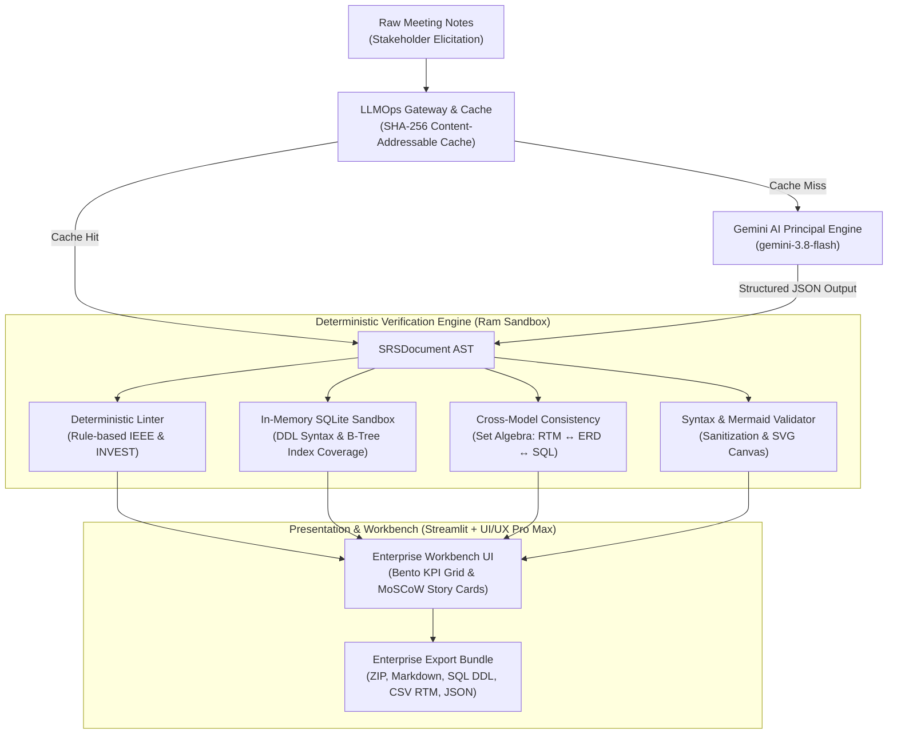

# System Architecture & Technical Specifications

## 1. High-Level Architecture Overview

The **BA & System Architect Copilot** transforms raw stakeholder elicitation notes into formal software engineering specifications adhering to international standards (**IEEE 29148:2018**, **BABOK v3**, and **Boyce-Codd / 3NF** database normalization).

---

## 2. Core Architectural Components

### A. Elicitation & LLMOps Telemetry Layer (`src/services/`)
- **Content-Addressable Cache (`telemetry_cache.py`)**: Computes a normalized SHA-256 digest of input notes and model parameters. Instant $O(1)$ memory lookup avoids redundant AI calls, achieving 0ms latency and 100% token savings on repeat analysis.
- **Resilient AI Pipeline (`ai_generator.py`)**: Uses the `google-genai` SDK with exponential backoff and jitter to defend against API rate limits (HTTP 429). Enforces strict Pydantic JSON Schema decoding.

### B. Deterministic Verification & Sandbox Layer (`src/validators/`)
- **Requirements Static Linter (`requirements_linter.py`)**: Evaluates requirements without AI hallucination. Flags subjective buzzwords ("dễ dùng", "nhanh chóng", "tối ưu") and scores SLA quantification.
- **In-Memory SQLite Sandbox (`db_sandbox.py`)**: Executes DDL in RAM (`:memory:`) to verify primary keys, foreign key constraints, and enforce Leftmost Prefix B-Tree index coverage. Provides auto-injection of missing indexes.
- **Cross-Model Consistency Verifier (`consistency_checker.py`)**: Uses set algebra to prove equivalence across 3 disparate models:
  $$\Delta = (T_{RTM} \cup T_{ERD} \cup T_{DDL}) \setminus (T_{RTM} \cap T_{ERD} \cap T_{DDL})$$
  Ensures $100\%$ alignment across business requirements, logical entity relations, and physical DDL tables.

### C. Enterprise Presentation & Theme Engine (`src/ui/`)
- **UI/UX Pro Max Tokens (`theme.py` & `design-system/MASTER.md`)**:
  - Fonts: `Plus Jakarta Sans` for typography hierarchy; `JetBrains Mono` for SQL, Mermaid, and telemetry.
  - Palette: Slate surfaces (`#f8fafc`, `#ffffff`) with Royal Indigo brand accents (`#4f46e5`, `#2563eb`) and semantic statuses.
  - Equal-height Bento KPI metric cards with integrated visual progress bars.
  - Smart Expander input layout maximizing workbench view space.

### D. Enterprise Exporter (`src/services/exporter.py`)
- Packages complete deliverables into a timestamped `.zip` bundle comprising:
  1. `01_SRS_<slug>.md`: IEEE 29148 formatted markdown specification.
  2. `02_Schema_<slug>.sql`: 3NF compliant PostgreSQL / ANSI DDL script.
  3. `03_RTM_<slug>.csv`: Requirements Traceability Matrix formatted for Excel (`utf-8-sig`).
  4. `04_Model_<slug>.json`: Complete Pydantic AST JSON document.
  5. `05_Sequence_<slug>.mmd`, `06_State_<slug>.mmd`, `07_ERD_<slug>.mmd`: Mermaid diagram sources.
